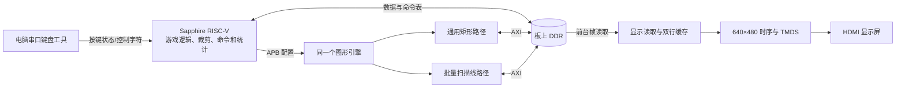

# 帧速引擎：架构、计算与开发接口

> **公开版范围：** 本文保留完整本地系统的实现与使用说明。厂商 IP、BSP、板级工程和烧录镜像不随公开仓库提供；涉及这些依赖的路径与命令，仅在自行补齐授权组件后适用。参见[仓库总览](../README.md)。

> 当前交付：`FrameSpeed_Flash_20261019`；软件版本：`49_SUITE_ALPHA50`。本文说明引擎及共享系统，包含计算公式、寄存器、C 接口、缓存/传输、显示和构建部署。

三份文档：[引擎开发说明](../01_Engine/README.md) · [Demo 说明](../07_Demo/README.md) · [游戏说明](../08_Game/README.md)。源码与命令中的路径以仓库根目录为基准；文件链接已按本文位置调整。

## 目录

1. [项目范围与功能](#1-项目范围与功能)
2. [目录与源码阅读顺序](#2-目录与源码阅读顺序)
3. [系统架构及任务分配](#3-系统架构及任务分配)
4. [像素、坐标、透明与计算公式](#4-像素坐标透明与计算公式)
5. [地址布局与内存所有权](#5-地址布局与内存所有权)
6. [通用矩形引擎的工作过程](#6-通用矩形引擎的工作过程)
7. [通用绘图接口与调用示例](#7-通用绘图接口与调用示例)
8. [批量精灵与逐行合成](#8-批量精灵与逐行合成)
9. [扫描线接口与描述符](#9-扫描线接口与描述符)
10. [透明包围框和逐行透明区间](#10-透明包围框和逐行透明区间)
11. [两类流水重叠与三类双缓冲](#11-两类流水重叠与三类双缓冲)
12. [AXI、突发、FIFO、仲裁与异常](#12-axi突发fifo仲裁与异常)
13. [显示输出、换帧与 FPS](#13-显示输出换帧与-fps)
14. [完整寄存器参考](#14-完整寄存器参考)
15. [菜单、Flash 布局与应用切换](#15-菜单flash-布局与应用切换)
16. [通过官方工具开发、仿真与调试](#16-通过官方工具开发仿真与调试)
17. [性能模型与验证](#17-性能模型与验证)
18. [常见问题与开发检查清单](#18-常见问题与开发检查清单)
19. [二次开发入口、来源与授权边界](#19-二次开发入口来源与授权边界)

## 1. 项目范围与功能

本项目在一颗 FPGA 内使用 Sapphire RISC-V 软核运行裸机 C 程序，以自定义硬件完成 RGB565 图像的填充、搬运、颜色键和透明合成；结果写入 DDR 帧缓冲，再通过独立显示模块输出 HDMI。Demo 与 Taisei 改编关卡使用同一份 FPGA 配置和同一套图形引擎，通过菜单互斥运行。应用操作与逻辑分别见 [Demo 说明](../07_Demo/README.md) 和 [游戏说明](../08_Game/README.md)。

这里的“软核”是由 FPGA 逻辑实现的处理器；“裸机”表示程序直接使用 BSP 和外设，没有运行 Linux。电脑在正常演示时负责串口键盘输入，也可按板卡实际供电配置提供供电，不负责计算游戏画面或逐帧向板卡传送图像。

### 1.1 当前版本的功能组成

| 功能 | 实现 |
|---|---|
| 矩形填充与图像块搬运 | RISC-V 通过 APB 配置，通用矩形硬件通过 AXI 读写 DDR |
| 颜色键与透明混合 | 通用矩形和批量扫描线两条路径均支持 |
| 大量精灵合成 | 片上图集、区域描述符、逐行合成和双行写回重叠 |
| 显示与换帧 | 640×480、60Hz HDMI，完整帧双缓冲 |
| 软件与硬件性能演示 | Demo 使用一致素材和绘制语义，显示实际新帧 FPS |
| 互动应用 | Taisei 改编关卡、菜单、串口按键输入 |
| 开发接口 | C 驱动、图像裁剪接口、描述符和寄存器访问 |

### 1.2 数据格式与接口边界

以下说明当前接口的适用范围，用于正确接入，不是待办功能清单。

- 已实现通用合法矩形尺寸的填充/搬运；并非只识别 12×12、24×24 或 32×32。
- 已实现统一 Alpha、颜色键、负坐标裁剪、源图裁切、逐行合成、双行合成/写回重叠、CPU 准备与 FPGA 绘制重叠。
- 已实现可选命令表 DMA、透明包围框、逐行透明区间；“存在可选路径”不等于“默认启用”或“任何素材上都提速”。
- 图像进入引擎前转换为 RGB565，并存入约定的 DDR 或片上图集；运行时通过源区域和目的坐标选择绘制内容。
- Alpha 使用每条绘图命令统一的 8 位值，范围 0～255。
- 显示模块独立扫描前台帧；图形引擎完成一帧后提交后台帧。显示器 60Hz 与实际生成新画面的 60 FPS 是两个指标。

## 2. 目录与源码阅读顺序

以下路径相对于本文所在的交付根目录。

| 路径 | 用途 |
|---|---|
| [01_Engine/fpga/rtl](../01_Engine/fpga/rtl) | 引擎、显示、板级顶层与参考设计 RTL |
| 01_Engine/fpga/par/ddr_demo_ti60/ddr_demo_ti60.xml（本地完整工程路径：`../01_Engine/fpga/par/ddr_demo_ti60/ddr_demo_ti60.xml`） | Efinity FPGA 工程入口 |
| [01_Engine/software/include](../01_Engine/software/include) | 通用搬运、扫描线、裁剪、透明元数据接口 |
| [01_Engine/software/src](../01_Engine/software/src) | 对应 C 驱动实现 |
| 01_Engine/BSP（本地完整工程路径：`../01_Engine/BSP`） | Sapphire 启动代码、板级驱动与 OpenOCD 配置 |
| [02_App](../02_App) | 菜单、素材暂存、Flash 读取与应用切换 |
| [03_Assets](../03_Assets) | 已转换素材、原图及素材元数据 |
| [04_Firmware](../04_Firmware) | FPGA 配置、应用 ELF/BIN/HEX、完整 Flash 镜像 |
| [05_SerialTool](../05_SerialTool) | 串口键盘工具、C# 源码、说明及测试 |
| [06_Verification](../06_Verification) | 构建、逻辑、像素、烧录和性能验证记录；引擎结果见本文件性能章节，应用结果见 Demo/游戏说明 |
| [07_Demo](../07_Demo) | 填充、双色图搬运、精灵压力测试和 CPU 对照 |
| [08_Game](../08_Game) | Taisei 改编关卡、游戏状态机与渲染调度 |
| [08_Licenses](../08_Licenses) | 第三方来源、许可和引用记录 |
| [shared/suite_switch.h](../shared/suite_switch.h) | 菜单/应用共享的切换接口 |
| [tests](../tests)、[tools](../tools) | 离线测试、构建、封装、加载及性能采集 |

建议先读 `fs_draw.h → fs_blitter.h → fs_blitter.c`，理解“绘制一个矩形”；再读 `fs_scanline.h → fs_scanline.c → fs_scanline.v`，理解“合成一批精灵”；之后读 `fs_scanout.v` 和应用主循环，理解帧何时能展示；最后读游戏和启动器。不要从 DDR 控制器内部开始学习整个项目。

主要自定义硬件文件的职责：

| 文件 | 职责 |
|---|---|
| [fs_blitter.v](../01_Engine/fpga/rtl/fs_blitter.v) | 两条绘制路径的 APB 选择、AXI 所有权互斥 |
| [fs_blitter_legacy.v](../01_Engine/fpga/rtl/fs_blitter_legacy.v) | 通用矩形填充、搬运、键控、Alpha、纹理缓存、前景预取 |
| [fs_scanline.v](../01_Engine/fpga/rtl/fs_scanline.v) | 图集加载、描述符、逐行合成、双行缓存、写回、命令 DMA |
| [fs_alpha565.v](../01_Engine/fpga/rtl/fs_alpha565.v) | RGB565 的流水乘加与精确取整 |
| [fs_read_arbiter.v](../01_Engine/fpga/rtl/fs_read_arbiter.v) | 图形引擎与显示读取的突发级仲裁 |
| [fs_scanout.v](../01_Engine/fpga/rtl/fs_scanout.v) | 帧缓冲读取、跨时钟行缓存、换帧与计数 |
| dvi_encoder.v（本地完整工程路径：`../01_Engine/fpga/rtl/dvi_encoder.v`）、encode.v（本地完整工程路径：`../01_Engine/fpga/rtl/encode.v`） | 显示数据的 TMDS 编码 |
| ddr3_example_top.v（本地完整工程路径：`../01_Engine/fpga/rtl/ddr3_example_top.v`） | 与 Sapphire、DDR、时钟和物理接口的板级连接 |

## 3. 系统架构及任务分配



CPU 执行：输入解析、固定步长时钟、敌机/子弹运动、碰撞、计分、Power、关卡状态机、素材索引、裁剪、描述符生成、硬件提交和统计。FPGA 执行：内存搬运、像素比较、乘加混合、行合成、突发读写、显示时序与编码。

“FPGA 可以并行”在本版中具体表现为：CPU 和图形硬件可以同时工作，合成器和写回器可以处理不同的行，显示器同时读取另一张帧缓冲。它不表示任意两个绘图命令都会自动由两个独立引擎执行，也不表示每个弹幕拥有一套硬件。

`fs_blitter.v` 中的通用路径与扫描线路径共享对外 AXI 端口，并且**互斥占用**。一种路径运行时，不能向另一种路径启动新的任务；相应 APB 写入会被拒绝。切换所有者的前提是已接受的 AXI 事务及其响应排空，不能在最后一个数据拍刚送出时就强行切换。

本版软件和引擎核心按 100MHz 工作；DDR 控制器包含其他时钟域，显示像素时钟为 25.2MHz。不要把 CPU 时钟、AXI/DDR 内部时钟、SDRAM 时钟和 HDMI 像素时钟混为一个频率。

## 4. 像素、坐标、透明与计算公式

### 4.1 RGB565 与内存排列

一个像素 16 位，即 2 字节：

```text
15          11 10             5 4           0
+-------------+----------------+-------------+
| R：5 位     | G：6 位        | B：5 位     |
+-------------+----------------+-------------+
R∈[0,31]，G∈[0,63]，B∈[0,31]
pixel = (R << 11) | (G << 5) | B
```

例如纯红 `0xF800`，纯绿 `0x07E0`，纯蓝 `0x001F`，纯黑 `0x0000`，纯白 `0xFFFF`。数据采用小端排列；一个 32 位 AXI 数据拍容纳两个 RGB565 像素，低 16 位对应较低字节地址处的像素。

已知图像首地址 `base`、每行字节跨度 `stride`，像素 `(x,y)` 的字节地址为：

```text
address(x,y) = base + y × stride + x × 2
```

跨度是“这一行开头到下一行开头”的距离，不必等于有效宽度乘 2。例如在 640 像素帧缓冲内绘制一个 37×19 矩形，目标跨度仍为 `640×2=1280` 字节，而不是 `37×2=74` 字节。

**接口单位必须区分：**`fs_command.src_stride/dst_stride`、`fs_image.stride`、`sl_frame.stride` 是字节；`sl_sprite()` 的 `source_stride`、源图集偏移是像素。`sl_load()` 的源地址是 DDR 字节地址，长度是 32 位字数。

### 4.2 颜色键控

颜色键控按源像素的完整 RGB565 值判断：

```text
if key_enabled && source_pixel == key:
    destination 保持原值
else:
    执行覆盖或 Alpha 混合
```

它不是“接近这个颜色就透明”，也不是 PNG 自带透明度。在颜色转换后，素材中的透明区域必须填成约定的键值。常用键是洋红 `0xF81F`，但双色搬运 Demo 使用红色 `0xF800` 作特定测试的键。键控先于混合，命中的透明色不会把洋红色混进画面。

### 4.3 Alpha 混合及乘法器的作用

每条命令的 `alpha=A` 为 0～255。对 R、G、B 三个原生分量分别计算：

```text
Z = foreground_component × A + background_component × (255 − A)
output_component = floor((Z + 127) / 255)
```

`A=0` 保留背景，`A=255` 完全采用前景，`A=128` 约为一半。红色 `0xF800` 与蓝色 `0x001F` 按 `A=128` 混合，结果为 `0x800F`。

RTL 不使用通用除法器逐像素除以 255。实现分三段寄存流水：

1. 分别计算前景乘 `A`、背景乘 `255-A`；
2. 求和并加 128，记为 `biased`；
3. `output = (biased + (biased >> 8)) >> 8`。

在本项目分量范围内，上式与前述四舍五入的 `/255` 相等。乘法器/DSP 是其中的算术部件；完整 Alpha 功能还需要取源像素、获得当前背景、流水延迟匹配、目标地址跟随以及写回控制，不能只用一个乘法器代表整个功能。

`fs_alpha565` 可同时处理一个 32 位字中的两个像素；**扫描线合成器的当前连接每周期使用其中一个像素结果**，不能据此宣称整套合成器每周期处理两个精灵像素。多个重叠精灵必须依序读取前面图层的合成结果，图层切换处要排空相关流水，避免读到尚未写回行缓存的旧值。

本版在 5/6/5 分量上直接计算，没有 gamma 校正。反复半透明叠加会逐层取整，因此合成顺序影响结果：通常 `blend(A,blend(B,C))` 不等于交换 A/B 后的值。

### 4.4 这里的“背景”究竟是哪一层

- 通用路径：Alpha 背景是目标 DDR 矩形的当前像素。
- 扫描线路径：先用纯色、DDR 背景或缓存小背景初始化当前行，再按描述符顺序叠加；Alpha 背景是当前行缓存中已经合成的像素。
- 当前版本的混合使用当前目标像素，**不以上一帧图像代替所有精灵的当前背景**。
- 把一个对象 Alpha 调到 0，只影响绘图；不会自动关闭它的碰撞、生命、弹幕计数或逻辑更新。看到的是其下方已经绘制的所有图层，不一定只是一张背景图。

### 4.5 矩形裁剪公式

目的矩形左上角 `(x,y)`、尺寸 `(w,h)`，画布尺寸 `(CW,CH)`：

```text
left   = max(x, 0)
top    = max(y, 0)
right  = min(x+w, CW)
bottom = min(y+h, CH)
```

若 `right<=left` 或 `bottom<=top`，无需发命令。否则新尺寸为 `right-left`、`bottom-top`，源图左上角前移 `left-x` 列、`top-y` 行。计算极端负坐标时使用足够宽的有符号中间值，避免 `-INT_MIN` 和 `x+w` 溢出。驱动已做这类边界检查。

## 5. 地址布局与内存所有权

### 5.1 地址范围和容量不是一回事

引擎允许直接 DMA 的范围是 `[0x00400000, 0x00C00000)`，即一个 8MiB 的**白名单窗口**。这不是整颗 DDR 的容量，也不是 CPU 只能使用这么多 DDR。CPU 应用执行区、DDR 暂存区、片上纹理 RAM 是不同存储区域。

| 区域 | 地址/规模 | 说明 |
|---|---|---|
| CPU 应用 RAM | `0x00001000` 起，`0x1F000=126976` 字节 | 124KiB，代码/数据/BSS/栈共同使用，含 4KiB 栈预算 |
| 图形 APB | `0xF8100000` | 以下寄存器表的统一基址 |
| 完整帧缓冲 A | `0x00800000`，614400 字节 | 640×480×2 |
| 完整帧缓冲 B | `0x00900000`，614400 字节 | 与 A 交换前台/后台角色 |
| HUD 暂存 | `0x00A00000` 起 | 两应用互斥使用；尺寸按各自渲染器定义 |
| 通用纹理缓存 | 2 槽，每槽 4KiB | FPGA 内部，不是 DDR 地址区 |
| 扫描线图集 | 8192 像素，16KiB | FPGA 内部；与通用缓存独立 |
| 扫描线描述符 | 最多 512 条/次任务 | 每条 16 字节；不是全游戏对象池容量 |
| 逐行透明元数据 | 最多 256 行 | 需要与当前图集及键值匹配 |

### 5.2 谁拥有内存，谁可以修改

一次提交的原则是：**CPU 完成写入 → 发布内存 → FPGA 独占使用 → 等待完成 → CPU 回收所有权。**

- FPGA 正在读的命令 bank、源素材和当前帧 UI 快照必须保持不变。
- FPGA 正在写的后台帧不能由 CPU 同时读改写；若 CPU 随后要检查像素，要先等待硬件完成，再执行缓存同步。
- 显示器正在扫描的前台帧不能作为当前绘制目标；否则即使帧率高也可能撕裂。
- `volatile` 只约束编译器对访问的处理，不能替代缓存清理、失效或内存屏障。

`fs_batch_begin/end()` 使用当前 Sapphire 的缓存同步机制，适合初次接入。优化版 `fs_batch_begin_write_through/end_write_through()` 依赖**当前核的写穿缓存**：它仅以屏障发布 CPU 写入，要求 CPU 不读取 DMA 目标，不存在其他写者。移植到写回缓存 CPU 时必须重新实现 clean/invalidate，不能直接沿用。

`fs_cache_sync()` 中的 `.word 0x0000500f` 是本版 Sapphire 使用的指令约定；它不属于任意 RISC-V 芯片都通用的缓存接口。不要随意替换成来源不明的 CSR 写入。

## 6. 通用矩形引擎的工作过程

### 6.1 操作类型

| op | 操作 | 数据访问 |
|---:|---|---|
| 0 | Solid Fill | 产生固定颜色并写目标，无需源图读取 |
| 1 | Block Copy | 读取源 RGB565，覆盖目标 |
| 2 | Color Key | 读取源，跳过等于键值的像素 |
| 3 | Alpha | 读取源和目标，统一 Alpha 混合 |
| 4 | Color Key + Alpha | 先跳透明色，其余混合 |

内部操作 5 用于显式纹理预装，由 `fs_texture_load()` 包装，不是供 `fs_submit()` 提交的普通绘图操作。

### 6.2 执行步骤

1. CPU 写操作、源/目标地址、行跨度、尺寸、颜色/键值/Alpha、命令序号。
2. CPU 写 start；硬件锁存本次参数，独立验证尺寸、对齐、地址区间及源目标重叠。
3. 填充路径直接形成数据；拷贝路径把源数据读入 FIFO；Alpha 还需读目标背景并通过乘加流水。
4. 每行按总线宽度、最大突发、4KiB 边界以及 FIFO 状态拆段。
5. 完成当前行后，源/目标行首按各自跨度前进，不把行尾 padding 当作图像有效像素。
6. 最后一个写响应完成后才置完成状态，并记录 completed sequence；若发生错误则按协议排空已接受事务后返回错误。

本路径保留了真正的任意矩形源地址和目标地址能力。它需要每个矩形配置、访问源图以及在 Alpha 模式下访问目标，适合基础接口、一般图像搬运和 HUD，不代表大量小精灵下最高吞吐率。

### 6.3 合法参数

- 非空矩形宽、高各不超过 4096；实际还受 DMA 地址窗口和跨度约束。
- 源/目标字节地址 2 字节对齐；跨度为偶数字节，至少 `2×width`，最多 65536。
- 最后一个有效像素后的地址用 64 位计算：`end=base+(height-1)×stride+2×width`，必须不超过 `FS_DMA_HI`。
- 拷贝/键控/混合的源、目标包围地址范围不能相交；硬件按包含跨度空隙的外包区间保守判断。
- 16 位像素即使只有 2 字节对齐也可合法；源/目的半字偏移不同会退回较慢路径。4 字节对齐通常更利于整拍搬运。
- 宽或高为 0 可作为底层空操作完成；高层裁剪接口遇到完全不可见矩形会直接成功返回，不发硬件命令。

### 6.4 纹理缓存与可复用配置

通用路径有两个各 4KiB 的纹理槽；小图可先加载，减少反复读 DDR。图像含 padding 的存储跨度也必须容纳于槽中，不能只看 `w×h×2`。

CPU 修改缓存对应的源像素后，必须失效并重新预装；否则读到的仍可能是旧内容。目标写入与缓存源重叠的失效处理不能替代 CPU 写源时的显式管理。大图无需装入纹理缓存，仍可直接从合法 DDR 地址搬运。

同一几何和效果多次绘制可用 `fs_blit_prepare()` 设置一次，再用 `fs_blit_submit()` 只更新地址和序号；每次仍需等待前一个任务完成。兼容函数 `fs_sprite_prepare()` 固定 32×32，仅为旧调用服务；新开发应使用通用接口。

## 7. 通用绘图接口与调用示例

头文件：[fs_blitter.h](../01_Engine/software/include/fs_blitter.h)、[fs_draw.h](../01_Engine/software/include/fs_draw.h)。

### 7.1 返回值和完成条件

| 返回值 | 含义 | 处理原则 |
|---|---|---|
| `FS_OK=0` | 本次 API 成功 | 异步提交成功并不表示绘制已经结束 |
| `FS_BUSY=-1` | 引擎被占用 | 等待原任务；不要强行覆盖参数 |
| `FS_BAD_PARAM=-2` | 软件检查参数不合法 | 修正参数，未进入正常绘制 |
| `FS_TIMEOUT=-3` | 轮询预算耗尽 | **没有取消任务**，仍可能在 DMA |
| `FS_HW_ERROR=-4` | 硬件完成并报告错误 | 查看对应错误码；完成并排空后再恢复 |
| `FS_BAD_ID=-5` | 驱动和位流版本不匹配 | 加载匹配 FPGA 配置 |

`fs_wait(seq,poll_budget)` 的预算是轮询次数，不是毫秒。正常完成条件是 `busy=0 && done=1 && complete_seq==seq`；必须同时判断序号，避免把上一个任务的 done 当作本次完成。

### 7.2 最小填充与非 32×32 图像搬运示例

以下是可集成到已有 BSP 工程的函数，不是另一个完整启动器。地址是**独立小实验的示例保留区**，不能直接与正在运行的游戏/Demo并发使用。调用前须完成 BSP/DDR 初始化，并确保目标为未被显示读取的后台帧。

```c
#include <stdint.h>
#include "fs_blitter.h"
#include "fs_draw.h"

#define EXAMPLE_FB  0x00900000u
#define EXAMPLE_IMG 0x00600000u
#define WAIT_POLLS  4000000u

static int engine_ids_ok(void) {
    return fs_read(0x000) == FS_ID &&
           fs_read(0x080) == 0x46534c06u &&
           fs_read(0x100) == 0x46534401u;
}

int example_fill_then_blit(void) {
    if (!engine_ids_ok()) return FS_BAD_ID;

    /* CPU 先生成 37×19 素材。实际项目可从离线转换的素材包加载。 */
    volatile uint16_t *pixels = (volatile uint16_t *)EXAMPLE_IMG;
    for (unsigned y = 0; y < 19; ++y)
        for (unsigned x = 0; x < 37; ++x)
            pixels[y * 37 + x] = x < 18 ? 0xf800u : 0x001fu;

    fs_command fill = {
        .op = 0, .dst = EXAMPLE_FB, .dst_stride = 1280,
        .width = 640, .height = 480, .color = 0x0000, .seq = 1
    };
    int rc = fs_submit(&fill);  /* 非批处理调用会同步缓存。 */
    if (rc != FS_OK) return rc;
    rc = fs_wait(1, WAIT_POLLS);
    if (rc != FS_OK) return rc; /* 超时后不能改写硬件仍在使用的内存。 */

    fs_surface target = { EXAMPLE_FB, 640, 480, 1280 };
    fs_image image = { EXAMPLE_IMG, 37, 19, 74 };
    fs_batch_begin();
    rc = fs_draw_image(&target, &image, 100, 80,
                       1, 0xf81f, 255, 2);
    if (rc == FS_OK) fs_batch_end();
    /* 发生超时则由上层等待排空/进入故障处理，不在这里提前归还所有权。 */
    return rc;
}
```

将 `op=1` 改为 `op=4`、`alpha=128`，可测试键控加半透明；素材确实包含键色时才会出现被跳过区域。把 `(100,80)` 改成 `(-5,80)`，可测试左边界裁剪。需要只搬源图的一部分时使用 `fs_draw_region()`，明确传入源区域 `(sx,sy,width,height)`。

`fs_draw_image/region()` 内部提交并等待完成，必须在排他 batch 内使用。它们对完全裁掉的图像返回成功但不产生新硬件序号，调用者不要再额外等待一个根本没发出的序号。

### 7.3 新应用的推荐调用层次

先用 `fs_draw_image()` 得到正确图像，再按需要迁移为 `fs_blit_prepare/submit()` 减少重复配置；大量同图集精灵使用后文 `sl_*` 接口。不要一开始绕过驱动手写所有寄存器，也不要将相同序号同时用于多种未完成任务。

实际提交前至少检查：没有另一条引擎路径运行、源目标归属合法、源已发布、目标是后台帧。完成后若要读像素，应先 `fs_cache_sync()`；若要显示，应按显示寄存器提交换帧。

## 8. 批量精灵与逐行合成

### 8.1 为什么需要另一条绘图路径

假设一行内有很多互相覆盖的半透明精灵。逐个矩形读写 DDR 会反复访问同一目标位置：读背景、混合、写背景，再为下一个精灵重复。批量路径把精灵纹理放在 FPGA 内部图集，先在片上行缓存合成，最后将这一行的最终结果写 DDR。

```text
初始化第 y 行背景
    ↓
按顺序查看本区域的所有描述符
    ↓
仅处理覆盖第 y 行的精灵
    ↓
读片上纹理 → 键控 → 读行缓存当前背景 → Alpha → 写行缓存
    ↓
该行所有图层完成后，将最终像素突发写 DDR
```

这种方式减少了外部目标像素反复读改写，但仍需要遍历描述符、读取纹理和逐像素合成。它不提供“精灵再多也没有成本”的叠加能力。

### 8.2 描述符是什么

一条描述符占 16 字节，描述“从图集中哪里取、在任务画布哪里画、多宽多高、用什么透明效果”。其中源是图集内的像素偏移，不是任意 DDR 字节地址。图集通过 `sl_load()` 预装，整批任务期间保持不可变。

硬件先验证任务和全部描述符，再逐行执行。每行按描述符数组顺序叠加，所以同一个区域内的顺序就是图层顺序。跨区域拆分时也要保持这一顺序，不能为了排序加速随意交换透明对象。

对于覆盖行 y 的描述符 `(x0,y0,w,h)`：

```text
active_on_row = y0 <= y < y0+h
source_row_offset = source_pixel + (y-y0) × source_stride_pixels
destination_column = x0 + local_x
```

描述符裁剪在 CPU 端完成一次，硬件不接受负的目的坐标。扫描线硬件仍独立校验，防止错误描述符越过图集或目标范围。

### 8.3 行缓存、合成流水和写回

合成端使用两套逻辑行缓存，每套最多 640 个 RGB565 像素。为适应同步 RAM 的读写和像素打包，每套逻辑行拆成偶/奇像素存储；“两套行缓存”不等于仅有两个 Verilog 数组。

一行的顺序是：

1. 取得空闲行 bank；
2. 用纯色或背景图填好；
3. 遍历描述符，对每个相交精灵发起纹理读取；
4. 键控通过的像素读取当前行背景，进入 Alpha 或覆盖路径；
5. 等待相关流水排空，再切到可能相交的后续图层；
6. 标记整行 ready，交给独立写回状态机；
7. 写回端发 AW/W，等待全部 B 响应，才归还该 bank。

最后一行发布不等于整批完成。必须确认两个 bank 的写回以及所有已接受事务均完成，才能置 done、允许 CPU 重新使用内存或者切换引擎路径。

### 8.4 纯色、DDR 与缓存背景

`sl_frame.color` 有三种含义：

| 模式 | 配置 | 用途 |
|---|---|---|
| 纯色 | RGB565 颜色值，模式高位清零 | 例如黑色背景 `0x0000` |
| DDR 背景 | `SL_DDR_BACKGROUND`，另填 `bg_source` | 当前游戏及原尺寸背景，背景跨度与目标任务跨度相同 |
| 缓存小背景 | `SL_CACHED_BACKGROUND(offset,output_y)` | 片上小图最近邻放大，适合可选低带宽背景 |

DDR 背景与目标区间不得重叠。它可以预取下一行，合成器使用当前行时读取端提前准备背景。不要把背景图指向当前正在写的后台帧来“节省一张图”，这会破坏明确的数据依赖。

缓存小背景按 64 像素宽、横向 10 倍、纵向 8 倍扩展到相应画面，画质和源图不同；它不是任意尺寸的硬件缩放器。原尺寸背景使用 DDR 路径，不强制走这个模式。

### 8.5 区域批处理如何工作

应用可将画面划分为多个水平区域，每个区域具有独立的目的起始地址、局部画布高度和描述符列表。具体应用参数分别见 [Demo 说明](../07_Demo/README.md) 和 [游戏说明](../08_Game/README.md)。

区域逐个提交给**同一个**合成器。区域本身仍逐行合成，不是 8 或 16 个同时运行的硬件引擎，也不是一帧只发生与区域数相等的 AXI 突发。

分区的主要作用是把“这一行可能相关的对象集合”缩小，降低每行无效扫描和每次任务的描述符压力。代价是跨区域的精灵需要拆成多条描述符，区域越多，CPU 裁剪、上传和启动次数也可能越多。

区域 `[band_top,band_bottom)` 与精灵 `[sprite_y,sprite_y+h)` 的交集：

```text
start = max(sprite_y, band_top)
end   = min(sprite_y+h, band_bottom)
if start < end:
    new_source = old_source + (start-sprite_y) × source_stride_pixels
    new_y      = start-band_top
    new_h      = end-start
```

各区域目的地址是 `framebuffer + band_top×frame_stride`；画布局部 y 从 0 开始。区域边界拆分不能让原图重复一行或丢失一行。

## 9. 扫描线接口与描述符

接口位于 [fs_scanline.h](../01_Engine/software/include/fs_scanline.h)，实现位于 [fs_scanline.c](../01_Engine/software/src/fs_scanline.c)。

### 9.1 限制与生命周期

- ID：`0x46534C06`。
- 图集最多 4096 个 32 位字，即 8192 个 RGB565 像素、16KiB；加载新图集会失效逐行透明元数据。
- 每次区域任务最多 512 个描述符；应用对象总量与该上限不是同一个参数。
- 任务宽度为偶数，范围 1～640；高度 1～480；目标地址 4 字节对齐；跨度 4 字节对齐、至少 `2×width`、不超过 65532。
- 源矩形可以是非正方形、非 2 的幂。辅助函数输入宽高各不超过 4096，但裁剪后的图集访问必须实际落在已装入范围内。
- 图集跨度以像素计，至少等于矩形宽，最多 8192；图像在图集中的末端必须不超容量。
- `sl_render()`、`sl_render_dma()` 提交后异步返回；必须调用 `sl_wait()` 或等价轮询。超时不取消 DMA。

### 9.2 主要 API

| API | 行为 |
|---|---|
| `sl_load(source,words,burst,seq)` | 从 DDR 字节地址同步加载图集；burst 1～32 拍 |
| `sl_sprite(out,source,stride,w,h,x,y,cw,ch,op,key,alpha)` | 生成并裁剪一条描述符；返回 1 有结果、0 完全不可见、负数为错误 |
| `sl_render(frame,commands,count)` | 验证后通过 APB 上传描述符并启动 |
| `sl_render_dma(frame,commands,count,dma_address)` | 验证后让 FPGA 通过 AXI 批量读取描述符，再合成 |
| `sl_wait(seq,budget)` | 等待对应任务完成 |
| `sl_line_overlap(1/0)` | 空闲时开启/关闭不同行的合成与写回重叠 |
| `sl_load_spans(rows,count,key)` | 上传最多 256 行透明区间元数据 |
| `sl_attach_spans(desc,original_source,first_row)` | 在裁剪完成后附加正确的元数据行号 |

### 9.3 16 字节描述符的位布局

`sl_descriptor` 由四个 `uint32_t` 组成，不能把 CPU 结构体指针直接解释成图像像素。

| 字 | 位 | 字段 |
|---|---|---|
| `source_stride` | `[12:0]` | 图集内源像素偏移 |
| 同上 | `[14:13]` | 保留，必须 0 |
| 同上 | `[15]` | span 元数据启用 |
| 同上 | `[29:16]` | 源行跨度，单位像素 |
| 同上 | `[31:30]` | span 首行编号的高 2 位 |
| `xy` | `[15:0] / [31:16]` | 区域内目的 x / y |
| `wh` | `[15:0] / [31:16]` | 宽 / 高 |
| `effect` | `[15:0]` | 颜色键 |
| 同上 | `[23:16]` | Alpha |
| 同上 | `[24]` | 颜色键使能 |
| 同上 | `[25]` | Alpha 使能 |
| 同上 | `[31:26]` | span 首行编号的低 6 位 |

普通无 span 描述符的元数据高位必须为零。推荐使用函数生成，不手工拼接；手工拼接必须遵守图集容量、坐标、效果位和保留位检查。

### 9.4 最小批量绘图示例

下面的示例与前一示例独立运行，使用相同实验内存区。所有对象共用一个 24×24 图案，但位置和 Alpha 可以独立设置；改为不同规格只需改变图集布局和 `sl_sprite()` 参数。

```c
#include <stdint.h>
#include "fs_scanline.h"

int example_scanline_batch(void) {
    const uint32_t src = 0x00600000u;
    const uint32_t dst = 0x00900000u;
    volatile uint16_t *tex = (volatile uint16_t *)src;
    for (unsigned y = 0; y < 24; ++y)
        for (unsigned x = 0; x < 24; ++x)
            tex[y*24+x] = (x == 0 || y == 0 || x == 23 || y == 23)
                          ? 0xf81fu : (x < 12 ? 0x07e0u : 0x001fu);

    int rc = sl_load(src, 24u*24u/2u, 32, 100);
    if (rc != FS_OK) return rc;
    rc = sl_line_overlap(1);
    if (rc != FS_OK) return rc;

    sl_descriptor d[2];
    unsigned count = 0;
    rc = sl_sprite(&d[count], 0, 24, 24, 24,
                   100, 100, 640, 480, 4, 0xf81f, 128);
    if (rc < 0) return rc;
    count += (unsigned)rc;
    rc = sl_sprite(&d[count], 0, 24, 24, 24,
                   112, 108, 640, 480, 4, 0xf81f, 192);
    if (rc < 0) return rc;
    count += (unsigned)rc;

    sl_frame frame = {
        .dst=dst, .stride=1280, .width=640, .height=480,
        .color=0x0000, .burst=32, .seq=101, .bg_source=0
    };
    rc = sl_render(&frame, d, count);
    if (rc != FS_OK) return rc;
    rc = sl_wait(101, 4000000u);
    if (rc != FS_OK) return rc;
    fs_cache_sync();  /* 若 CPU 要读回结果；只展示时按显示流程换帧。 */
    return FS_OK;
}
```

本例清整张任务画布为黑，再叠加图案。若要保留已有复杂背景，应选择 DDR 背景或生成相应背景任务，不能认为扫描线任务天然保留目标旧像素。

### 9.5 命令表 DMA 的正确使用

APB 路径由 CPU 逐字上传四个描述符字；DMA 路径将命令表保存在 DMA 可访问 DDR 内，由硬件突发读入。二者最终执行相同的像素合成。

使用 DMA 时，`commands` 指针必须确实映射到传入的 `dma_address`，不能把栈上的数组和另一个任意 DDR 地址一起传入。命令表长度为 `count×16`，地址 4 字节对齐且范围合法；CPU 在提交前发布写入，直到完成都不能修改这张表。

DMA 描述符字节数约为 `16N`，最大 32 拍时一次最多读取 128 字节；512 条需要 8192 字节，理想情况下至少 64 次命令读取突发，遇 4KiB 边界还要分段。它与每行背景读取和最终帧写回的突发数是三类不同计数。

本版默认继续使用 APB 命令上传。不能仅凭“DMA”这个名称断言更快：硬件要读命令并验证，CPU 端的生成/验证成本仍在，且命令流和显示/背景争用读端口。应在同样的对象、效果、背景与区域布局下实测选择。

## 10. 透明包围框和逐行透明区间

### 10.1 透明包围框

对不可变素材，以颜色键 K 扫描，求所有 `pixel!=K` 的最小外包矩形 `(left,top,width,height)`。例如 24×24 素材只有中央 12×16 有内容，可把绘图范围缩小到 12×16，同时将目的位置补偿 `(left,top)`，保持图案在原位置。

```text
new_source = source + top×source_stride_pixels + left
new_x = old_x + left
new_y = old_y + top
```

CPU 可在素材载入时计算一次，或离线生成。它不应每帧对每个实例重新扫一遍图像。一个材质的元数据可被大量实例复用。完全透明的素材记录宽高为 0，直接跳过绘图。

实现接口见 [fs_sprite_trim.h](../01_Engine/software/include/fs_sprite_trim.h) 与 [fs_sprite_trim.c](../01_Engine/software/src/fs_sprite_trim.c)。裁减只改变绘制数据，**不改变游戏碰撞盒**。仅在颜色键开启且元数据与键值一致时使用；如果关闭键控而只做 Alpha，原来键色也应作为正常颜色绘制，此时不能仍按透明包围框丢弃。

### 10.2 逐行透明区间

包围框内部仍可能存在很多行首/行尾透明像素。逐行元数据为每一行记录非键色内容的 `[first,end)`，硬件只遍历该区间与当前裁剪范围的交集。

```text
原行：KKKKKXXKXXXKKKK
区间：     [      )       first 指向第一个 X，end 是最后一个 X 后一位
```

中间的 K 仍需颜色键判断；本版每行仅一个区间，不是多段 RLE。它可以跳掉左右透明边缘，不能直接跳过所有内部洞。

元数据每行一个 32 位字：`entry=first|(end<<13)`；first 是图集绝对像素偏移、13 位；end 是 14 位独占末端，可取 8192；高 5 位保留为 0。空区间表示这一行全透明。

元数据顺序：加载图集 → 以同一键值生成/上传区间 → 生成普通裁剪描述符 → `sl_attach_spans()` 附加对应起始行。裁掉顶部后，元数据行号也要前移，不能仍从原图第一行读取。重新加载图集、修改素材或改键值，都需重新建立匹配关系。

本版硬件提供该可选功能，测试操作见 [Demo 说明](../07_Demo/README.md)。普通路径是基准选择。对于较实心的小图，节省的像素不足以抵消元数据和 CPU 准备成本，关闭它完全合理，不能把它写成默认一定有收益的“无损加速倍增”。

## 11. 两类流水重叠与三类双缓冲

### 11.1 CPU 准备与 FPGA 绘制重叠

应用有两套命令 bank 和两份帧快照。FPGA 读 bank A 绘制帧 N 时，CPU 在 bank B 更新下一帧逻辑并构建命令；当前任务完成后再交换。

```text
时间 ───────────────────────────────────────────>
FPGA       绘制 N / bank A        绘制 N+1 / bank B
CPU        准备 N+1 / bank B      准备 N+2 / bank A
展示       提交完成的后台帧      提交下一张完整后台帧
```

当前帧的命令和 UI 快照保持不变。CPU 不能在硬件还没读完时覆盖当前 bank，也不能在画面 N 的 HUD 中误用已经推进到 N+1 的生命/得分快照。

串行耗时近似 `Tprepare+Trender`；理想重叠后近似 `max(Tprepare,Trender)`，再加不可隐藏的提交、HUD、换帧和收尾。不是把 CPU 时间简单“消掉”。如果 CPU 来不及准备，硬件结束后仍需等待剩余工作，记录为准备溢出/尾部耗时。

### 11.2 双行合成与写回重叠

这发生在 FPGA 内部：合成第 y+1 行的 bank B，同时把第 y 行的 bank A 写 DDR。两行不共享同一个目标缓存 bank，所以可以并行。

```text
合成器       合成行 0/A   合成行 1/B   合成行 2/A ...
写回器                    写回行 0/A   写回行 1/B ...
```

不能把 bank A 发出最后一个 W 拍就立即复用；必须等待相应写响应。若写回因 DDR 背压较慢，合成器到达仍被占用的 bank 时会暂停，这种暂停是正确的流控，不是功能错误。

`sl_line_overlap(0)` 用于串行调度对照，仍使用相同的两套物理 RAM，不是重新生成一份硬件。它和 CPU 双命令 bank 是两个独立开关。

### 11.3 必须区分的三种缓冲

| 名称 | 装的是什么 | 解决什么问题 |
|---|---|---|
| 帧缓冲 A/B | 两张完整输出画面 | 前台显示、后台绘制，防止撕裂 |
| 命令 bank A/B | 两批描述符及其快照 | CPU 准备与 FPGA 执行重叠 |
| 合成行 bank A/B | 两行临时 RGB565 像素 | FPGA 合成与写回重叠 |

显示模块另外还带跨时钟的双行读取缓存，用于准时供像素，与上述合成行缓存不是同一组存储。屏幕划成 8/16 区域又是另一概念，不等于双缓冲。

## 12. AXI、突发、FIFO、仲裁与异常

### 12.1 一次突发不是一次屏幕区域任务

图形端 AXI 数据宽度 32 位，1 拍 4 字节；地址自增突发为 INCR，`AxSIZE=2`，`AxLEN=拍数-1`。默认上限 32 拍时，一个突发最多 128 字节，即 64 个 RGB565 像素。

一行 640 像素是 1280 字节，至少分成 10 个这样的写突发；480 行就是 4800 个写突发。一行游戏区 448 像素是 896 字节，分 7 个，480 行共 3360 个。这里还没算显示读取、DDR 背景读取、命令 DMA、HUD 和特殊边缘。

AXI 的要求是合理利用突发，避免大量低效单拍；不是要求“一帧突发越少就一定越好”。过长突发也可能延迟显示的实时读取，因此需要考虑仲裁和响应时间。

### 12.2 4KiB 边界和有效字节

任意一次 AXI 突发不能跨越 4KiB 地址边界。对 4 字节对齐的整拍任务，可以用下面的规划思想：

```text
beats_to_page_end = (4096 - (address & 4095)) / 4
burst_beats = min(remaining_beats, configured_limit, beats_to_page_end)
AxLEN = burst_beats - 1
```

通用路径还需考虑源/目的半字偏移、行末单像素、FIFO 容量和有效字节。`WSTRB[3:0]` 表示这一拍哪些字节有效；奇数宽或半字边缘必须保留不属于矩形的相邻像素，不能把 padding 或另一个像素一起覆盖。

### 12.3 FIFO、预取与缓存的区别

- FIFO 暂存流水数据，吸收读写速度差异，数据随任务推进消费。
- 通用路径以前景双 bank FIFO 及混合数据暂存支持突发，填充上限 16 拍、拷贝整拍路径可到 32 拍；具体长度还受边界约束。
- 通用纹理缓存让小图被重复读取；扫描线图集也是可复用纹理存储，但接口和容量不同。
- 背景预取在需要前取下一行，降低等待；它不是用过去一帧的背景替代正确背景。
- 行缓存保存正在合成的目标像素，减少反复访问 DDR；帧缓冲才保存最终完整图像。

### 12.4 显示读取仲裁

`fs_read_arbiter.v` 在图形读取与显示读取间仲裁。显示在**突发边界**拥有优先权；已经接受的突发必须走到 RLAST，不能读到一半切换接收者。该仲裁器一次维持一个在途读取突发，并把相应响应送回原请求者。

写回和显示读处于不同任务流程，但最终仍共享 DDR 服务能力。增加引擎数量不自动增加 DDR 带宽；不加约束地增加突发长度，也可能导致显示欠载。

### 12.5 协议不变量与错误恢复

发出 VALID 后，在 READY 前必须保持相应地址/数据/控制稳定；数据和响应只在 `VALID&&READY` 时推进。RLAST/WLAST 必须与声明拍数一致，BRESP/RRESP 非 OKAY 要报告错误。

错误恢复的关键是**排空已接受事务**。软件超时只是观察到等待过久，不具备取消总线事务的能力。错误后不能立即复用缓存、切换另一引擎或者清空 RAM；应等待明确的 idle/完成错误状态，或按调试流程复位整个相关系统。重置仅一个状态机而留下未完成 AXI 响应，会导致下一任务错收数据。

## 13. 显示输出、换帧与 FPS

### 13.1 HDMI 的实际分辨率

本版 HDMI 有效图像为 **640×480**。显示器面板可以是 1080p，但其内部缩放不改变 FPGA 输出分辨率。时序如下：

| 项目 | 水平 | 垂直 |
|---|---:|---:|
| 有效 | 640 | 480 |
| 前肩 | 16 | 10 |
| 同步 | 96 | 2 |
| 后肩 | 48 | 33 |
| 总计 | 800 | 525 |

像素时钟 25.2MHz，名义刷新率 `25200000/(800×525)=60Hz`。HS 在 x∈[656,752) 为负，VS 在 y∈[490,492) 为负。RGB565 各分量通过复制高位扩展到 RGB888，再进入 TMDS 输出图像。

### 13.2 显示行读取与跨时钟

显示从当前 front 地址按固定 1280 字节跨度读每行 320 个 32 位字，使用 16 拍、64 字节的读取突发，每行 20 次。帧基址 4KiB 对齐，行跨度是 64 的倍数，固定突发不会跨 4KiB。

读取时钟域和像素时钟域通过 req/ack 翻转标志及同步寄存器交换行请求，行号/epoch/状态等载荷在握手期间保持稳定。缓存行号和帧 epoch 必须同时匹配，不能把上一帧同奇偶行的数据当作新行。

若一行未按时准备好或读失败，本版选择整行黑色并计欠载，避免错位显示随机数据。黑条可能来自显示带宽/时序/缓存握手问题，不能只凭黑条判断板卡损坏；查看 `underrun`、`axi_errors` 和回归位流更有依据。

### 13.3 完整帧双缓冲与提交

绘制流程：在后台 FB 完成所有区域和 HUD → 等绘图 DMA 全部结束 → 配置 next base/sequence → commit → 等 accepted sequence → 交换软件的前后台角色。

```c
#include <stdint.h>
#include "fs_blitter.h"

static void display_write(uint32_t off, uint32_t value) {
    *(volatile uint32_t *)(FS_BASE + off) = value;
}

/* 调用前：fb 已完整绘好、GPU 空闲、缓存已按所有权约定处理。
 * poll_budget 是轮询次数，超时不表示换帧请求已被取消。 */
int example_present(uint32_t fb, uint32_t sequence, uint32_t poll_budget) {
    if (fs_read(0x100) != 0x46534401u) return FS_BAD_ID;
    if ((fb & 4095u) || fb < 0x00400000u || fb > 0x00b69000u)
        return FS_BAD_PARAM;
    if (fs_read(0x104) & 2u) return FS_BUSY;
    display_write(0x108, fb);
    display_write(0x10c, sequence);
    __asm__ volatile("fence rw,rw" ::: "memory");
    display_write(0x110, 1);
    while (poll_budget--)
        if (fs_read(0x114) == sequence) return FS_OK;
    return FS_TIMEOUT;
}
```

使用新的非零序号。accepted 表示请求已经在显示边界被接受，不表示该帧所有像素已经完整扫描到屏幕；完整新帧计数由显示模块后续更新。不得在 pending 请求未被接受时重复覆盖提交。

### 13.4 FPS 的计算与解释

```text
FPS×10 = round(Δ完整新帧计数 × 10000000 / Δ时间_微秒)
FPS    = (FPS×10) / 10
```

例如 `fps10=600` 表示 60.0 FPS，`300` 表示 30.0 FPS，不是 600 FPS。扫描计数 `scans` 可以一直约为 60/s，而新帧仅 30/s，这意味着重复输出旧画面。

新帧识别依据不同的已提交序号和完整显示状态，不是比较整帧像素哈希。因此静止场景重复提交不同序号也会计入；要证明动态渲染性能，还应记录逻辑 tick、对象运动、工作耗时、欠载和错误。冻结画面用于正确性检查，不能代替动态压力测试。

## 14. 完整寄存器参考

统一基址 `0xF8100000`，表内地址为相对偏移，32 位访问。R=只读，W=写，RW=配置读写；未列地址不作为扩展可用承诺。APB 为零额外等待接口，写错误由 PSLVERROR 报告；调用 C 驱动仍须遵守空闲和参数约束。

### 14.1 通用路径 `0x000～0x07F`

| 偏移 | 权限 | 名称/位含义 |
|---:|:---:|---|
| `0x000` | R | ID=`0x46530107` |
| `0x004` | RW | status：bit0 busy，bit1 done，bit2 error；写 bit1/bit2 清相应锁存标志 |
| `0x008` | W | start，bit0 启动 |
| `0x00C` | RW | op，普通操作 0～4 |
| `0x010` | RW | 源 DDR 字节地址 |
| `0x014` | RW | 目的 DDR 字节地址 |
| `0x018` | RW | 源跨度，字节 |
| `0x01C` | RW | 目的跨度，字节 |
| `0x020` | RW | 矩形宽，像素 |
| `0x024` | RW | 矩形高，像素 |
| `0x028` | RW | 填充颜色，低 16 位；内部预装操作用于选槽 |
| `0x02C` | RW | 颜色键，低 16 位 |
| `0x030` | RW | Alpha，0～255 |
| `0x034` | RW | 提交序号 |
| `0x038` | R | 完成序号 |
| `0x03C` | R | 错误码 |
| `0x040` | R | 当前/最近任务核心周期 |
| `0x044` | R | 读字节数 |
| `0x048` | R | 写字节数 |
| `0x050` | R | 能力位集合，本版 `0x3F` |
| `0x054` | RW | 纹理缓存 bit0 使能、写 bit1 失效；读 `[9:8]` 为两槽 valid |
| `0x058` | R | 累计命中突发数 |
| `0x05C` | R | 累计未命中突发数 |
| `0x060` | R | 累计节省的前景 DDR 读取字节 |
| `0x064` | RW | 前景预取 bit0 使能 |
| `0x068` | R | 预取命中计数 |
| `0x06C` | R | 预取重叠周期计数 |
| `0x070` | R | 扩展签名 `0x50465231`，ASCII PFR1 |

通用硬件错误码：1 操作不合法；2 几何/对齐/Alpha 等参数不合法；3 DMA 范围；4 源目标重叠；5 AXI 读错误；6 AXI 写错误；7 非法内部状态。软件的负返回值与这些硬件正错误码是两套编码。

### 14.2 扫描线路径 `0x080～0x0FF`

| 偏移 | 权限 | 名称/位含义 |
|---:|:---:|---|
| `0x080` | R | ID=`0x46534C06` |
| `0x084` | R | bit0 busy，bit1 done，bit2 error |
| `0x088` | W | 命令：1 APB 描述符绘制，2 图集加载，3 DMA 描述符绘制 |
| `0x08C` | RW | 目标 DDR 字节地址 |
| `0x090` | RW | 目标跨度，字节 |
| `0x094` | RW | `[15:0]` 宽、`[31:16]` 高 |
| `0x098` | RW | 本区域描述符数，0～512 |
| `0x09C` | RW | 背景颜色/模式：bit30 DDR，bit31 缓存小背景 |
| `0x0A0` | RW | 图集加载源 DDR 字节地址 |
| `0x0A4` | RW | 图集加载长度，32 位字 |
| `0x0A8` | RW | 命令 DMA 源字节地址 |
| `0x0AC` | RW | 提交序号 |
| `0x0B0` | RW | 描述符上传字指针；写任意值回到 0，只允许顺序上传 |
| `0x0B4` | W | 依次上传四字描述符并自动递增字指针 |
| `0x0B8` | RW | 最大突发拍数，1～32 |
| `0x0BC` | R | 错误码 |
| `0x0C0` | R | 最近任务核心周期 |
| `0x0C4` | R | 读字节数 |
| `0x0C8` | R | 写字节数 |
| `0x0CC` | R | 完成序号 |
| `0x0D0` | R | 当前有效图集长度，32 位字 |
| `0x0D4` | R | 已处理像素数，包括进入处理范围后被键控跳过的像素 |
| `0x0D8` | R | 描述符访问次数，含逐行判断 |
| `0x0DC` | RW | DDR 背景源字节地址 |
| `0x0E0` | W | 清空 span 表计数 |
| `0x0E4` | W | 顺序写入 span 条目 |
| `0x0E8` | R | 有效 span 行数 |
| `0x0EC` | RW | span 表对应颜色键，低 16 位 |
| `0x0F0` | RW | bit0 双行重叠使能；读取为 `0x00040100 | enabled` |
| `0x0F4` | R | span 区间跳过的像素数 |
| `0x0F8` | R | 命令 DMA 读取字节数 |
| `0x0FC` | R | 命令 DMA 突发数 |

扫描线硬件错误码：1 命令/突发参数；2 图集加载参数；3 目标几何/范围/描述符数；4 描述符内容；5 AXI 读错误；6 AXI 写错误；7 背景参数；8 span 元数据；9 命令 DMA 参数。

### 14.3 显示路径 `0x100～0x1FF`

| 偏移 | 权限 | 含义 |
|---:|:---:|---|
| `0x100` | R | ID=`0x46534401` |
| `0x104` | R | bit0 enabled、bit1 pending |
| `0x108` | RW | 下一张完整帧基址；4KiB 对齐、`0x400000～0xB69000` |
| `0x10C` | RW | 下一张帧序号 |
| `0x110` | W | commit，pending 时或地址非法会拒绝 |
| `0x114` | R | 已接受帧序号 |
| `0x118` | R | 当前 front 帧基址 |
| `0x11C` | R | 完整扫描次数 |
| `0x120` | R | 完整新帧显示次数 |
| `0x124` | R | 显示欠载行计数 |
| `0x128` | R | 显示 AXI 读取错误计数 |

## 15. 菜单、Flash 布局与应用切换

### 15.1 RAM 加载与 Flash 烧录的区别

| 内容 | 保存位置 | 断电结果 |
|---|---|---|
| FPGA `.bit` 临时配置 | FPGA 配置 SRAM | 丢失；再次上电按 Flash 启动配置 |
| 调试器下载的 CPU/素材 | CPU RAM/DDR | 丢失 |
| 完整 Flash 镜像 | 板上 SPI Flash | 保留，直到主动擦写 |

复位键是否重启 CPU/重新配置取决于板卡电路，但普通复位不会凭空擦除 Flash。可以重新写镜像、备份恢复或使用工具擦除；本项目没有把 Flash 写死为不可修改。仅将相同代码改为从 Flash 启动，不会自动提高 FPS，因为运行时仍在片上 CPU RAM 和 DDR 中访问数据。

### 15.2 为什么菜单、Demo、游戏分开编译

游戏 CPU 区已占约 98.9%，三个应用全部链接到一个 124KiB 执行区不可行。于是 Flash 保存三个独立程序；启动时先把它们暂存 DDR，选择入口时由 DDR 中的小型汇编跳板把所选程序搬到相同 CPU RAM，再执行。

这种方式复用同一软核、同一执行 RAM、同一图形硬件。没有在 FPGA 里塞三颗 CPU，也没有让电脑参与应用切换后的计算。

### 15.3 Flash 当前布局

完整文件：FrameSpeed_Suite_flash.hex（本地完整工程路径：`../04_Firmware/FrameSpeed_Suite_flash.hex`），从 Flash 地址 `0x000000` 写入。物理 Flash 已识别为 8MiB，本版镜像解码长度 `0x39F000=3796992` 字节，至少需要 4MiB 存储空间。

| 内容 | Flash 地址 | 字节数 |
|---|---:|---:|
| FPGA 配置及现有启动格式 | `0x000000` | 866056 |
| Suite 头 | `0x0E0000` | 72 |
| Demo CPU 槽 | `0x0E1000` | 126976 |
| Game CPU 槽 | `0x100000` | 126976 |
| Game 素材 | `0x120000` | 1460652 |
| Demo 背景包 | `0x290000` | 553024 |
| Menu CPU 槽 | `0x380000` | 126976 |

CPU 槽填充到 `0x1F000`，空隙填 `0xFF`。地址是 Flash 地址，不是 CPU 执行地址，也不是 DDR 素材源地址。

**HEX 格式要区分：**完整 Suite 文件和 FPGA 配置 HEX 为本流程使用的原始十六进制字节文本；Suite 每行一个字节，不是 Intel HEX。CPU 工程生成的 Intel HEX 是应用编译产物；本交付仅提供完整 Suite Flash 镜像作为烧录入口，组件文件放在 `04_Firmware/components`。

### 15.4 Suite 头字段

头为 18 个 little-endian `uint32_t`：

```text
word 0：magic = 0x46535549
word 1：format_version = 1
word 2：release = 0x26101851
word 3..17：依次为 Menu、Demo、Game、Demo背景、Game素材
            每项三个字：Flash地址、字节数、CRC32
```

CRC32 用于检测传输/存储错误。当前启动器检查大小、4 字节对齐、魔数/版本和 CRC，确认容器与应用/素材数据一致后加载。

### 15.5 启动和跳板步骤

初次启动时现有平台启动流程把 Menu 从 Flash 加载到 CPU `0x1000`。Menu 读取 Suite 头并将应用和素材拷贝到 DDR：

| 内容 | DDR 暂存地址 |
|---|---:|
| 切换跳板 | `0x01000000` |
| 元数据 | `0x01010000` |
| Menu | `0x01100000` |
| Demo | `0x01120000` |
| Game | `0x01140000` |
| Demo 背景包 | `0x01400000` |
| Game 素材包 | `0x01500000` |

这些 DDR 地址高于图形 DMA 白名单，但由 CPU 正常读写；不要为了允许它们而无依据地扩大引擎 DMA 范围。

选择后调用 `suite_switch_app(0/1/2)`：

1. CPU 跳到 `0x01000000`，从此不再依赖将被覆盖的应用指令、栈或 GP；
2. 跳板关闭中断，检查 app 编号；
3. 按 Demo/Game 选择把素材包拷到相应活动 DDR 区；
4. 从 `0x01100000+(app<<17)` 将完整 `0x1F000` 字节程序槽搬到 CPU `0x1000`；
5. 写 `mscratch=0x4653574D` 暖启动标记，执行数据/指令缓存同步；
6. 跳到 `0x1000`，由应用启动代码重新建立 GP、SP、BSS 和 BSP。

跳板 [chain.S](../02_App/src/chain.S) 是不使用栈的汇编，不能简单用普通 C 的 memcpy 原地覆盖当前应用。返回菜单时，启动器利用暖启动标记和一致的元数据复用 DDR 暂存；普通冷启动仍从 Flash 装载校验。

若改程序槽大小、暂存地址、素材包格式或头顺序，要同步修改 C、汇编、链接脚本、封装脚本和切换测试。单独通过调试器启动 Game/Demo 时，若没有初始化 Suite 跳板和暂存，**不要按 M**；独立应用的正常绘制不代表整套菜单切换环境存在。

## 16. 通过官方工具开发、仿真与调试

### 16.1 工具的分工

| 工具 | 做什么 | 不做什么 |
|---|---|---|
| Efinity | 编辑 RTL、IP/接口配置、综合、布局布线、时序分析、生成 FPGA 配置 | 不负责把 C 游戏逻辑自动变成图形电路 |
| Efinity RISC-V IDE | 编辑 C/汇编、调用 GCC、链接、调试 CPU 和内存 | 不综合 FPGA RTL |
| 串口工具 | 键盘输入和运行日志 | 不负责生成画面 |
| Python 辅助程序 | 自动调用官方工具、封装、测试与收集数据 | 不参与板卡运行时渲染 |

本机使用 Efinity `2026.1.132.4.5` 及对应 RISC-V 环境，主目录 `F:/Efinity/2026.1`。换电脑可修改 `EFINITY_HOME`；路径是本机配置，不要求所有开发者都建 F 盘。先匹配参考工程和 IP 版本，不直接用其他厂商工具代替。

### 16.2 Efinity 硬件工程

打开 ddr_demo_ti60.xml（本地完整工程路径：`../01_Engine/fpga/par/ddr_demo_ti60/ddr_demo_ti60.xml`），目标 Titanium/Ti60F225，当前板卡 Ti60F225I3 对应 **I3 timing model**。顶层为 `ddr3_example_top`，约束入口包括 ddr3.sdc（本地完整工程路径：`../01_Engine/fpga/par/ddr_demo_ti60/sdc/ddr3.sdc`）。

开发步骤：

1. 建立独立修改分支，保留已知可运行的位流及源码哈希；
2. 修改模块和相应仿真，先验证功能/握手/边界；
3. 运行综合，检查锁存器、未连接端口、RAM 推断、乘法资源和高位截断；
4. 使用现有 Interface/IP/引脚配置，不凭名称重新分配板级引脚；
5. 布局布线，查看 setup、hold、跨时钟和约束覆盖；
6. 确认工程输出与 RTL 一致，成对保存 JTAG `.bit` 与 SPI 配置 `.hex`；
7. 临时 SRAM 加载后测试，再决定是否更新 Flash。

不要把只含 APB 参数寄存器的 `fs_blitter` 空壳当作整套工程直接下载；真正工程需要 AXI、DDR、软核、显示、时钟/复位与引脚连接。也不能只因“综合没有语法错误”就判断时序和总线协议正确。

### 16.3 RISC-V IDE 软件工程

分别导入 Existing Projects：

| 文件夹 | 工程名 |
|---|---|
| `02_App` | `FrameSpeed_Release_Menu` |
| `07_Demo` | `FrameSpeed_Release_Demo` |
| `08_Game` | `FrameSpeed_Release_Game` |

三个工程使用普通 C、汇编、BSP、Makefile。核心编译参数包括 `-march=rv32im_zicsr_zifencei -mabi=ilp32 -O2`，链接脚本为各应用 `suite.ld`，不是 PC 的 x86 可执行程序。

`07_Demo` 与 `08_Game` 含同名但不同用途的 `taisei_game.h/taisei_render.c`，Demo 启用自己的紧凑结构配置；**不能把两个目录的所有 C 文件一起通配链接，也不能混用它们的头文件搜索顺序**。应分别构建，只共享 `01_Engine` 接口。

Build Project 输出 `build/framespeed.elf/.bin/.hex/.map`。ELF 含符号及调试加载段；Game ELF 包括素材段，而 CPU BIN/Intel HEX 导出时排除了素材段。只下载 CPU BIN 而没有装相应素材，无法组成完整可运行环境。

IDE 调试时可在提交前、完成后、关卡状态变更等位置设断点，查看结构体/内存/寄存器；不要在 FPS 测量时单步。CPU 暂停不会让独立显示时序也暂停，屏幕显示旧图不表示硬件继续生成新画面。实板调试必须先建立匹配位流和 DDR 初始化条件。

### 16.4 重新构建整个交付镜像

在本目录运行 重新生成交付镜像.cmd（本地完整工程路径：`../04_Firmware/重新生成交付镜像.cmd`），或者用合适 Python 执行：

```powershell
$env:EFINITY_HOME = 'F:/Efinity/2026.1'
python tools/build_suite.py
```

该程序调用官方 RISC-V IDE 的 headless build，分别干净构建三个工程，复制输出，生成跳转入口、124KiB 程序槽、Suite 头、完整镜像和 manifest。它只离线构建，**不会烧录板卡**。

它会校验当前 `.bit` 与硬件来源记录及 RTL 哈希匹配，但不会自动执行一次 Efinity RTL 综合。修改 RTL 后，必须自己生成新的匹配 bit/FPGA hex，完成硬件验证并更新相关记录；不要简单删掉哈希检查以混用不匹配硬件。

重新构建会重新生成 manifest，部署记录按对应镜像分别保存。运行素材转换、源码修改后，也要更新发布哈希清单，并将后续部署结果关联到新的文件哈希。

### 16.5 离线测试

可以在不连接板卡的情况下使用：

```powershell
python tools/test_game.py
python tools/test_demo.py
python tools/test_switcher.py
```

这些测试依赖当前配置的官方 GCC/QEMU 等工具，部分图像检查需要 Pillow；具体环境按脚本定位。本机可用环境不代表另一台电脑无需安装依赖。测试通过后仍需匹配位流的实板验证。

测试覆盖逻辑、裁剪、像素、命令生成和实际链接跳板的指令/内存守卫等。QEMU 的执行时间不能当作 FPGA 帧率，内存模型也不能替代 Sapphire 缓存、真实 DDR 背压、引脚和显示时序。

### 16.6 Flash 部署

正式 Flash 流程使用 写入Flash并验证.cmd（本地完整工程路径：`../04_Firmware/写入Flash并验证.cmd`） 和 [board_flash.py](../tools/board_flash.py)。流程是识别、备份、写入/校验、启动测试；其中 `program` 会实际擦写，不是只读检查。工具默认端口 COM6，换电脑可通过 `--port` 指定实际端口。识别/备份所用临时桥接配置也会暂时影响当前 FPGA 运行画面。

```powershell
python tools/board_flash.py probe --port COM6
python tools/board_flash.py backup --port COM6
python tools/board_flash.py program --port COM6
python tools/board_flash.py boot_test --port COM6
```

上面是操作说明，阅读文档不会执行命令。烧录前保存原 Flash 备份并确认芯片、容量、目标地址和镜像；烧录后做工具校验和回读，再按板卡手册完成真实断电重启观察。电脑无需关机才能停止使用板卡，但接线/断电顺序必须遵循实际板卡手册；本文不凭照片推定某个开关的位置或电源规格。

### 16.7 屏幕熄灭与电脑睡眠

仅关闭背光/熄屏一般不停止计算；系统睡眠/休眠会中断下载、测试和串口。长时间构建或板测应保持系统唤醒、确认供电稳定，避免 USB 省电导致链路中断。工具中的临时保持唤醒只对相应运行期间生效，不能代替对系统电源策略的确认。

## 17. 性能模型与验证

### 17.1 流量与时间模型

640×480 RGB565 完整帧为 `640×480×2=614400` 字节，60Hz 显示读取约 `36.864MB/s`，这里 MB 为十进制百万字节。

例如 448×480 画布每帧 `430080` 字节；60FPS 写回约 `25.8048MB/s`，原尺寸 DDR 背景读取再约 `25.8048MB/s`。三项合计约 `88.4736MB/s`，尚未计算 HUD、命令、CPU、仲裁损耗、行边缘和其他读写。

100MHz、32 位端口假设每周期一拍时的算术上限为 `400MB/s`；实际有效带宽受 READY、读写切换、刷新、仲裁和协议开销影响，不能把这个理论数当作已测 DDR 吞吐。

| 工作项 | 简化成本 | 优化方向 |
|---|---|---|
| CPU 逻辑 | 活动对象、碰撞候选、发射和状态机 | 定点/查表、有效索引、减少空池扫描 |
| CPU 命令准备 | 对象×区域相交、描述符数、验证/上传 | 区域筛选、不可变快照、双 bank 重叠 |
| 纹理处理 | 被遍历像素及透明覆盖层数 | 合理材质尺寸、包围框/区间、避免无意义图层 |
| 目标写回 | 画布有效像素量 | 行缓存一次合成写回、双行重叠、有效突发 |
| DDR 读取 | 背景/显示/命令/通用源图 | 片上图集、预取、仲裁、适当突发 |

放大精灵通常增加像素处理量，重叠多会增加混合量；缩小图案通常能容纳更多对象，但命令和游戏逻辑成本未同比减少。相同“1000 个对象”，12×12 与 24×24、单层与多拖尾、屏内与屏外，不能作为同一个负载。

### 17.2 引擎与部署验证

三个官方 RISC-V IDE 工程构建通过；链接后跳板字节的指令/内存守卫检查及菜单/应用实际切换通过。Flash 官方校验和完整回读匹配通过；重载 FPGA 配置后，CPU 和素材由 Flash 加载，未再次下载 CPU/素材替代启动。

匹配硬件资源为 XLR 45118、RAM10 253/256、DSP 27/160，最低 setup/hold 裕量记录为 0.117/0.025ns，100MHz 核心路径 setup 裕量 0.658ns。该记录绑定到当前位流；修改 RTL 后重新检查资源和时序。片上 RAM 已接近上限。

[manifest.json](../04_Firmware/manifest.json) 标识固件文件，[启动记录](../06_Verification/flash_install/boot.json) 与 [运行记录](../06_Verification/flash_install/runtime.json) 保存对应实板结果。Demo 的 24×24 容量、CPU/FPGA 对比及游戏密集段性能分别见 [Demo 说明](../07_Demo/README.md) 和 [游戏说明](../08_Game/README.md)。

### 17.3 计数与日志含义

| 字段 | 含义/注意 |
|---|---|
| `fps10` | 实际完整新帧 FPS 的 10 倍 |
| `new_frames/scans/sample_us` | 新帧数、扫描次数、真实采样时间 |
| `work_max_us/work_avg_us` | 换帧等待前的工作耗时，不是单纯 FPGA 时间 |
| `logic_max_us/prepare_max_us` | CPU 逻辑和准备耗时，存在包含/重叠关系 |
| `core_cycles` | 硬件任务周期，按应用聚合；换算需使用对应核心频率 |
| `descriptors/descriptor_visits` | 实际描述符和逐行访问规模，不等于可见对象数 |
| `read_bytes/write_bytes` | 硬件数据流量，不是电脑串口字节 |
| `cmd_bytes/cmd_bursts` | 命令表 DMA 专属流量与突发数 |
| `skipped_pixels` | span 优化跳过的像素；不是所有颜色键透明像素总量 |
| `over_budget` | 工作时间超过约 16.667ms 的帧数 |
| `underrun/axi_errors` | 显示欠载/读取错误，不能只看 FPS 而忽略 |

降低统计频率能减少部分 CPU/串口开销，但不能把删除错误检查后“看起来正常”作为正确性证据。当前日志采用缓冲、非阻塞发送，不会每帧同步打印整屏数据。

## 18. 常见问题与开发检查清单

| 现象 | 优先核对 |
|---|---|
| `wrong bitstream` / `FS_BAD_ID` | 三个 ID、位流哈希、是否只更新了软件而仍用不匹配硬件 |
| 图片斜行、花纹或错色 | RGB565、小端、字节/像素跨度、源偏移单位 |
| 左右多改一个像素 | 2 字节边缘、WSTRB、奇数宽与源目的半字偏移 |
| 区域边界接缝/重复行 | band 局部 y、源行前移、上下界半开区间 |
| 半透明图层异常 | 键控顺序、图层顺序、Alpha 取整、流水排空和行缓存所有权 |
| 改素材后仍旧图 | 图集/通用缓存是否失效重载；是否重建 BIN/CRC/头文件 |
| 黑色横条/局部不显示 | 显示 underrun、AXI 错误、行 epoch/CDC、读端口竞争与时序 |
| `FS_BUSY` 或 APB 写错误 | 两路径互斥、前任务未完成、配置写入发生于 busy |
| 等待超时后下一次更乱 | 超时未取消 DMA，是否过早覆盖命令/源/目标或局部复位 |
| 链接 RAM 溢出 | CPU 124KiB 限制，不是 DDR 不足；对象池/栈/静态表增大 |
| 仅下载 CPU BIN 无画面 | 还需匹配位流、DDR 初始化、素材加载与正确程序入口 |
| 顶栏只显示一半字 | 字模尺寸、HUD 实际跨度、裁剪、脏行范围与双 FB 更新 |
| 串口连接失败/界面卡住 | 端口选择、驱动、其他占用程序、USB 链路；先看工具日志 |
| FPS 卡在 30/20/15 | 先看 work 与换帧错过周期；60Hz 下错过边界会重复旧帧 |
| 扫描一直 60 但运动慢 | 检查新帧 FPS、逻辑 tick、补步/丢步，而非只看刷新率 |
| 烧录成功但不自动启动 | 镜像格式/地址、板卡启动配置、真实断电测试；勿以 RAM 加载冒充 |

### 18.1 修改一个模块的最小闭环

1. 写清更改目标和保持不变的语义，例如“只减少透明边缘处理，像素必须相同”；
2. 在相同输入上做软件参考/硬件模型像素对照，覆盖负坐标、非规则矩形、奇数宽、跨度、透明重叠和极端地址；
3. 若动 RTL，加入 AXI 随机背压、错误响应、4KiB 边界和完成所有权检查；
4. 检查综合/时序/资源；若仅动 C，也检查 RAM 和栈预算；
5. 上板先 RAM，不先覆盖唯一可用 Flash；检查启动像素、FPS、工作耗时和错误；
6. 使用相同模式与负载测性能，记录位流/应用/素材 SHA、测试条件和时长；
7. 生成发布镜像，更新 manifest、哈希和文档，再做部署/启动验证。

### 18.2 新开发者应该先做的实验

先按第 7 节填一张纯色帧并搬一个 37×19 图像，确认地址/跨度；再把图像部分放到画外，确认裁剪；接着用第 9 节合成两个交叠透明图案，确认图层和 Alpha；应用压力实验见 [Demo 说明](../07_Demo/README.md)，每次只改变一个变量。这样能定位“算法、驱动、传输、显示”中的具体问题。

## 19. 二次开发入口、来源与授权边界

### 19.1 修改位置与接口约束

| 目标 | 推荐入口 | 约束 |
|---|---|---|
| 支持新矩形规格 | 通用 `fs_draw_*` 或图集 `sl_sprite` | 地址/跨度/图集/画布限制，不需要尺寸专用硬件 |
| 优化命令准备 | 分区筛选、描述符生成、CPU 重叠 | 保留图层次序、当前 bank 不可变 |
| 增加新的硬件效果 | 描述符/寄存器/像素流水 | 同步版本 ID、驱动、模型、资源和时序 |
| 换开发板 | 板级顶层、IP、时钟、引脚、BSP | 同芯片不代表存储/接口/工程兼容 |

开发时先按本版计数定位瓶颈：CPU 逻辑慢，应检查逻辑与命令准备；像素处理量大，应检查材质和图层；DDR 拥塞，应检查流量、突发和仲裁。修改后仍需保持现有像素语义、内存所有权和完成条件。

### 19.2 哪些部分来自哪里

- 自定义图形 RTL、C 驱动、平台定点状态机、调度、测试、串口工具和本文包含 AI 协助。团队应通过学习、验证和记录形成自己的设计理解，不能把生成内容描述成未经辅助的独立成果。
- Sapphire、DDR 控制器、板级接口/时钟/IP 和 BSP 基于易灵思 Ti60F225 DemoBoard V4 参考设计。源码中的厂商版权与受保护代码保持其原有授权条件。

应用素材与上游许可见 [Demo 说明](../07_Demo/README.md) 和 [游戏说明](../08_Game/README.md)。

公开到 GitHub 时，应将本说明、可分发的自定义代码、构建约定和测试一起放入仓库；对厂商参考设计、受保护 IP、素材和第三方文件逐项保留许可/版权并确认分发范围。本文描述的是技术实现与来源，不是对所有第三方内容作无限制再分发承诺。

### 19.3 当前交付的身份

| 项目 | 值 |
|---|---|
| 软件版本 | `49_SUITE_ALPHA50` |
| 通用引擎 ID | `0x46530107` |
| 扫描线引擎 ID | `0x46534C06` |
| HDMI 显示 ID | `0x46534401` |
| FPGA bit SHA256 | `82541577a76d2a25d7a62f0fb9ae3c68a641af6004f68c9cf081a194d71a32cd` |
| 完整 Flash HEX 文件 SHA256 | `1156cee98ffe37d0ecbac6fcbb3f2fc1bb2d942999de42a73133e825218372b0` |

以上是对应文件本身的哈希；HEX 文本哈希与解码后的二进制哈希不是同一个值。本文与 Demo/游戏说明只整理现有实现，未改引擎、应用、素材或固件。
